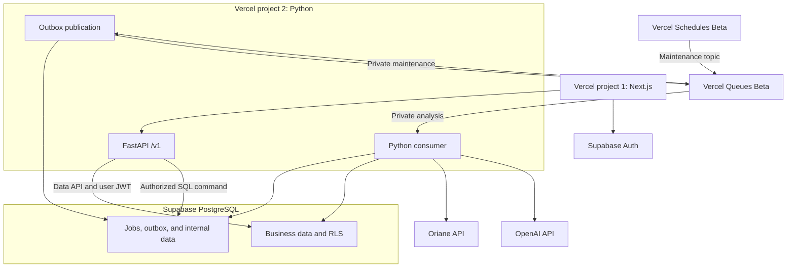

# ViralEat target architecture

**Version:** 0.1  
**Date:** 2026-11-07  
**Status:** Target specification to implement.

This document defines the architectural decisions for the ViralEat MVP. It does not claim implementation, technical validation, provider connectivity, or deployment. [API.md](API.md) defines the HTTP contract. [features.md](features.md) defines the functional scope.

## 1. Scope and core decisions

The architecture supports the benchmark and market corpora defined in [features.md, section 1](features.md#1-mvp-objective). The two corpora share ingestion and extraction but retain separate scope, coverage, and consumption records.

| Component | Target decision |
|---|---|
| Frontend | Next.js and TypeScript in `apps/web`, Vercel project 1. |
| Backend | FastAPI and Python in `apps/api`, Vercel project 2. |
| Identity and data | Supabase Auth and PostgreSQL. |
| Asynchronous processing | Vercel Queues with push delivery and Python consumers in the backend project. Queues is still in Beta. |
| Technical recovery | Vercel Schedules Beta publishes to a private maintenance topic to recover the outbox. |
| Collection | Oriane API, through a server adapter that validates responses. |
| AI analysis | OpenAI, with structured outputs validated by the backend. |
| Relational storage | PostgreSQL represents entities and many-to-many relationships. |
| Outside the MVP architecture | Neo4j, Redis, Celery, and a third deployment project. |

Python on Vercel has been generally available since October 15, 2026. The Queues Python SDK supports push subscribers. Its build produces private functions triggered by the queue. Runtime availability and Queues availability are separate statuses. Sources: [Python GA](https://vercel.com/changelog/python-on-vercel-is-now-generally-available), [Queues](https://vercel.com/docs/queues), [Python SDK](https://vercel.com/docs/queues/python-sdk).

### Two corpora with deduplicated ingestion

- The benchmark corpus contains content associated with the five confirmed establishments.
- The market corpus contains content that matches the niche, territory, period, and watch queries. It can include other restaurants and creators.

Each analysis processes one corpus. [API.md, sections 6 and 7](API.md#6-asynchronous-analyses) define analysis types and budget enforcement. [.env.example](.env.example) defines the initial configuration defaults. The pipeline records consumption across attempts and reserves budget before paid calls.

A content item can belong to both corpora. The workspace stores it once and counts it once in each corpus to which it belongs. The application does not deliberately charge again for a reusable extraction because the content appears in several searches.

The report preserves each corpus's scope. A benchmark result does not automatically become a market trend.

## 2. Project structure and responsibilities

The paths below describe target responsibilities. The initial frontend now exists in `apps/web`; see its [implementation guide](apps/web/README.md) for the implemented screens and unconnected service boundary. Backend paths and the remaining responsibilities are still targets.

| Location | Responsibility |
|---|---|
| `apps/web` | Sign-in, restaurant configuration, benchmark, market view, creators, opportunities, and analysis tracking. |
| `apps/web/lib/api` | Typed HTTP client generated from, or checked against, the backend OpenAPI contract. |
| `apps/api/app/routes` | `/v1` routes, input validation, and translation of errors into public responses. |
| `apps/api/app/auth` | Supabase JWT verification and workspace access checks. |
| `apps/api/app/connectors` | Oriane and OpenAI adapters. |
| `apps/api/app/pipeline` | Collection, normalization, entity association, extraction, calculations, and synthesis. |
| `apps/api/app/jobs` | Outbox, queue publication, consumption, recovery, cancellation, and limits. |
| `apps/api/app/repositories` | Data API access under the user JWT and separate internal SQL repositories. |
| `supabase/migrations` | Schemas, constraints, roles, privileges, and RLS policies to create during implementation. |
| `tests/fixtures` | Explicitly labeled, isolated test fixtures and evaluation cases. |

Implementation must pin dependencies and runtimes and retain their lockfiles. Installation, migration, and deployment commands cannot be assumed operational before the code exists and versions are selected.

## 3. Runtime architecture

The browser uses Supabase Auth to obtain a session and calls the business API with its access token. FastAPI never accepts an OpenAI or Oriane key in a user request body.

`POST /v1/analyses` starts an analysis. After durable storage, the API returns `202 Accepted` and an identifier. The frontend polls `GET /v1/analyses/{id}`. The HTTP connection does not wait for collection and AI calls to finish.

The main resources include workspaces, restaurants, benchmark and watch settings, sources, benchmark reports, market reports, creators, opportunities, and annotations. API.md centralizes paths and schemas.

## 4. Data access and tenant isolation

### 4.1. The workspace is the tenant

A `workspace` defines the isolation boundary. `workspace_members` links Supabase users to the workspace and their role. The MVP does not need an additional `organization` object.

A client-supplied `workspace_id` is a selector, not proof of access. The backend verifies the JWT and then checks membership stored in the database. It does not trust an `organization_id`, role, or user metadata supplied in a request.

Every business resource has a `workspace_id`. Constraints on resource references prevent links between different workspaces. UUIDs make identifiers opaque but never replace authorization checks.

### 4.2. User CRUD through the Data API and JWT

Ordinary reads and changes pass through FastAPI, then the Supabase Data API with the user's JWT and the project's publishable key. RLS policies check workspace membership for each permitted operation.

Exposed tables receive explicit privileges limited to necessary operations. RLS controls accessible rows. SQL privileges control access to objects. Calculated data, reports, evidence, and counters are read-only for users. Actions and annotations use separate tables.

Update policies check both the existing row and the new row. Users cannot move a resource to another workspace or grant themselves a role. Any exposed views must respect the caller's privileges. Sources: [Data API security](https://supabase.com/docs/guides/api/securing-your-api), [RLS](https://supabase.com/docs/guides/database/postgres/row-level-security).

### 4.3. Internal commands and workers use restricted SQL

Analysis creation is a specific exception to CRUD. The backend checks membership, scope, and limits, then inserts the job and its outbox event in one SQL transaction. A PostgreSQL request and a Vercel Queues call are not atomic together.

`DATABASE_URL` identifies a transaction pooler connection with a dedicated, restricted server role. This role is not a table owner or superuser and has no `BYPASSRLS` privilege. It receives the privileges needed for internal commands, processing, and report projections. The user flow requires no `service_role` key.

The `private` schema is not exposed through the Data API. It contains the outbox, steps, raw provider payloads, and extraction cache. RLS adds protection. A worker SQL connection does not inherit the user JWT. Its workspace context comes from the persisted job. Filters, constraints, and any transaction context must use this trusted value, never a value from a client message.

The connection uses TLS with certificate verification, the application pool size configured in [.env.example](.env.example), and disabled prepared statements for the shared transaction pooler. Session state must not be assumed to survive between transactions. The root certificate and hostname depend on the actual connection. Source: [Supabase PostgreSQL connections](https://supabase.com/docs/guides/database/connecting-to-postgres).

### 4.4. Identity verification and public boundaries

The backend verifies the JWT signature, issuer, audience, and expiration. The target uses asymmetric keys and the Supabase project's JWKS. The cache must support key rotation. Decoding a session alone does not authenticate it. Source: [Supabase JWTs](https://supabase.com/docs/guides/auth/jwts).

Routes check access to requested objects even after authentication. CORS is limited to configured frontend origins. CORS is not access control. Access and refresh tokens never appear in application URLs or logs. Authentication callbacks may receive short-lived confirmation or authorization codes; consume them without logging them, then redirect to a clean application URL.

Only public URLs and the Supabase publishable key can be exposed to the frontend. PostgreSQL credentials, provider keys, and scheduling secrets stay in the server environment. [.env.example](.env.example) is the sanitized configuration template. The private `.env` file has not been inspected.

### 4.5. Email and password authentication

Supabase Auth manages credentials, email confirmation, password verification, and recovery. The Next.js application uses Supabase Auth for these flows. FastAPI receives the resulting access JWT for business requests. Application tables never store passwords.

Enable the email/password provider and require email confirmation before the first sign-in. Configure the hosted project's Site URL, allowed confirmation and recovery redirects, email templates, and password policy in Supabase Auth settings. These settings are not application environment variables. Use the deployed frontend URL and explicit development URLs rather than client-supplied redirect destinations.

For the Next.js server-rendered flow, use the supported Supabase SSR integration and its PKCE flow. Handle confirmation and recovery callbacks, establish the appropriate session, and remove codes from the visible URL. Validate any return destination as a local, allowed path. A password-update page requires a validated recovery session before changing the password. Invalid or expired links lead to a recoverable error rather than an authenticated workspace.

Configure custom SMTP in Supabase Auth for delivery to actual users. Supabase's default mail service is restricted and is not a production delivery solution. Store SMTP credentials in Supabase settings; the application does not need a second mail sender or SMTP environment variables. Verify delivery of confirmation and recovery messages before release.

Sign-out clears the current application's session and authenticated caches. Independently issued access JWTs may remain valid until expiry; clearing browser state does not instantly revoke every token. Backend authorization continues to follow section 4.4.

Implementation checks cover sign-up awaiting confirmation, a valid confirmation, invalid credentials, expired or reused links, password recovery, session refresh, and sign-out. Product-facing acceptance criteria remain in [F01](features.md#f01-landing-page-and-user-account).

References: [Supabase password authentication](https://supabase.com/docs/guides/auth/passwords), [Supabase custom SMTP](https://supabase.com/docs/guides/auth/auth-smtp), and [Supabase SSR](https://supabase.com/docs/guides/auth/server-side).

## 5. Relational model and evidence

PostgreSQL tables and relationships represent the product graph. A video can discuss several restaurants, present several products, and link to several creators. A relationship is recorded as confirmed only when its provenance is available.

| Logical group | Target data and relationships |
|---|---|
| Identity | `workspaces`, `workspace_members`. |
| Reference data | `restaurants`, addresses, aliases, and the profile and positioning declared by the restaurant owner. |
| Configuration | Benchmark versions, five selected establishments, and market watch scope versions. |
| Creators | `creators` and platform accounts. Display names alone do not justify merging two accounts. |
| Content | Platform identity, Oriane identifier, observed author, dates, and source URL when available. |
| Many-to-many relationships | `content_restaurants`, `content_creators`, `content_products`, and `content_topics`. |
| Corpora | `corpora` and `corpus_items`: benchmark or market type, query, inclusion, exclusion, and reason. |
| Versions | Useful text versions, provider references, and content fingerprints. |
| Measurements | `metric_snapshots`: counters observed for each content item and platform at a given time. |
| Evidence | `evidence`: exact excerpt, source, modality, speaker, and available temporal position. |
| Observations | Product, price, aspect, opinion, format, novelty, or association, with evidence and uncertainty status. |
| Execution | `analysis_jobs`, `analysis_attempts`, `job_steps`, `outbox`, and provider consumption. |
| Results | Immutable reports, opportunities, and links to selected evidence. |
| User tracking | `creator_selections(workspace_id, user_id, creator_id)`, action statuses, and an optional annotation extension, separate from calculated results. |

RLS protects business tables and readable projections. Raw provider responses and detailed execution data stay private. A source's HTTP response does not automatically return the entire Oriane payload.

### Data invariants

- A post's logical identity is `(platform, platform_content_id)`. MVP storage uniqueness includes `workspace_id` to keep isolation simple. The Oriane identifier remains a separate provider identifier.
- A content item appears at most once per corpus. Links to several restaurants do not multiply the corpus's total post count.
- Cross-platform reposts can be linked as variants without merging their counters.
- An audio track is identified by `audio_key=(platform, audio_platform_id)`. Identical titles do not justify merging tracks. A track without an identifier remains unresolved.
- An ambiguous restaurant name remains unresolved until further evidence or a recorded user correction is available.
- Evidence specifies its origin: caption, transcript, comment, or observed frame. It preserves the exact text and supplied timestamp. The LLM does not invent timecodes.
- An opinion distinguishes the creator's statement, a reaction, and an experience reported in a comment. A reported experience is not a verified purchase.
- An observation exposes `experience_basis`: `reported_experience`, `content_reaction`, or `unspecified`.
- A price is a dated observation with an amount, currency, product, meal deal, and source. It does not replace the current menu.
- Human corrections are versioned annotations. They do not silently rewrite the source.

Creator selections use the concurrency contract in [API.md, section 10.1](API.md#101-creators). The backend derives the user from the JWT and checks workspace access. The uniqueness constraint covers the workspace, user, and creator.

## 6. Time, snapshots, and immutable reports

Four dates have different meanings: `published_at`, `provider_updated_at`, `fetched_at`, and `report_created_at`. They are stored with time zones and compared in UTC. A provider update date is not treated as the exact measurement time of a counter.

A new observation adds a metric snapshot. An increase between two snapshots can be calculated when dates, content, and metrics are comparable. A counter decrease is retained and flagged as a possible correction or anomaly. It is not arbitrarily converted to zero growth.

One view observation cannot reconstruct the previous week's growth. Charts based on publication dates count posts. Charts based on snapshots measure counter differences. The application explicitly distinguishes them.

Each report freezes:

- The settings version, period, and selected corpora.
- The content versions and snapshots used.
- The evidence, numerators, denominators, and missing elements.
- The calculation, extraction schema, prompt, and model versions.
- The analysis attempt and coverage warnings.

A refresh produces a new report. A retry preserves previous reports. User views can point to the latest report without rewriting history. Functional immutability has an exception for mandatory source withdrawal, deletion, or anonymization. The required change is recorded, and the affected evidence becomes unavailable or redacted. Dependent conclusions are also reviewed and hidden when necessary. The interface explains the limitation without fabricating evidence.

## 7. Bounded asynchronous pipeline

### 7.1. Steps

| Step | Input and persisted result |
|---|---|
| Preparation | Benchmark or market type, validated parameters, configuration version, budgets, and scope of the relevant corpus. |
| Collection | Bounded Oriane pages, query provenance, received data, and any partial errors. |
| Normalization | Deduplicated identities, dates, null values, and candidate relationships. |
| Qualification | Niche and territory relevance, establishment association, and exclusion reasons. |
| Extraction | Small batches of text and evidence, with validated structured observations. |
| Measurements | Deterministic calculations by corpus and platform, coverage, and available temporal comparisons. |
| Synthesis | Explanations and opportunities linked to evidence. The model invents no indicators. |
| Publication | Immutable reports, final status, and recorded consumption. |

Each step processes a bounded volume. Search pages and extraction batches are resumable units. Pagination loops and provider waits cannot continue indefinitely.

[.env.example](.env.example) defines the initial attempt, concurrency, and step-timeout settings. Each external call timeout leaves time to save its result or failure before the step expires. Internal concurrency for paid calls must remain bounded without implicitly multiplying consumer concurrency.

### 7.2. Outbox and publication recovery

1. The backend creates the job and outbox event in the same transaction. The initial state is `pending_dispatch`.
2. After commit, the request attempts a brief publication with a timeout. The dispatcher reserves the event with a short lease, then publishes outside the transaction. A failure leaves the event durably pending. Detached in-memory execution cannot replace this persistence.
3. The message contains the job, attempt, and step identifiers. It contains no complete corpus, user JWT, or provider key.
4. A stable idempotency key identifies the published event. After acceptance, the dispatcher records the send.
5. If the process stops between sending and recording, another publication is possible. The consumer must therefore tolerate duplicates.
6. A reconciler recovers pending events and expired leases. In the hosted environment, a static Vercel Schedules Beta schedule publishes to the configured `QUEUE_MAINTENANCE_TOPIC`. A separate Python consumer runs this maintenance in bounded batches within the backend project.

This queue target requires neither a public maintenance HTTP route nor `CRON_SECRET`. Deployment configuration defines the cadence according to the selected plan. It does not promise exact timing. Leases and idempotent operations make repeated maintenance delivery safe. Source: [Vercel Schedules](https://vercel.com/docs/schedules).

This technical recovery schedule does not start new business analyses. It is separate from the business refresh controlled by `FEATURE_SCHEDULED_REFRESH`. Local tests explicitly trigger the same reconciler.

The Python SDK handles message acceptance, lease renewal, and acknowledgment. An exception causes redelivery. Acknowledgment occurs only after the step result is persisted. Source: [Queues Python SDK](https://vercel.com/docs/queues/python-sdk).

### 7.3. Idempotency and errors

A unique key containing the job, attempt, and operation identifies a step. The result is saved before the next step starts. Redelivery of a completed step returns its existing result.

The extraction cache uses a fingerprint of useful data, the versioned extraction context, schema, prompt, and model. A change in view count does not trigger another analysis of the same transcript. Comments can be invalidated separately.

Temporary errors receive bounded retries with delays. Authentication errors, missing configuration, and invalid input do not trigger a loop of paid calls. Queue deliveries, step retries, and analysis attempts are tracked separately.

Before a paid call, an atomic reservation checks the remaining budget. This prevents two consumers from jointly exceeding a limit that they read separately. Consumption returned by the provider adjusts the reservation. An unknown cost stays labeled as an estimate or reservation and is not presented as an exact bill.

A failure after a provider call but before saving its result can cause another call. The application therefore promises neither exactly-once execution nor exactly-once external billing. It reduces this risk through prompt persistence, operation keys, and the idempotency capabilities each provider actually offers.

### 7.4. Worker and dispatcher coordination

[API.md, section 6.4](API.md#64-states-and-transitions) defines public states and transitions. [API.md, section 7](API.md#7-idempotency-retries-cancellation-and-budgets) defines retries, cancellation, and budgets.

The consumer can receive a message before the dispatcher records `queued`. It must be able to claim a `pending_dispatch` job. The dispatcher updates publication state conditionally so a late update cannot move `running` back to `queued`.

The worker checks cancellation between operations and before final publication. Persisted step results let another delivery resume the remaining work. Technical status does not replace coverage. A completed search with no content records insufficient data rather than zero visibility.

## 8. Oriane observable data and limits

The target adapter uses the documented routes `POST /rest/contents/search` and `POST /rest/profiles/search` at `https://connect.oriane.xyz`. The schema provides `limit` from 1 to 100, `offset`, and `basic`, `default`, or `full` projections. Pagination remains subject to application budgets.

For visual-search pagination, the adapter retains and reuses `aiSearchAnchor` as required by the provider contract. Optional asset creation remains disabled until a product need and the account contract justify it. These integration details require validation against the [Oriane REST documentation](https://connect.oriane.xyz/rest/docs) before implementation.

The full projection describes transcript segments, on-screen text, frames with URLs and timestamps, and up to 15 popular comments. Audio metadata includes `audioPlatformId`, `audioTitle`, `audioAuthor`, `audioType`, and `audioCopyrighted`. Availability must be checked in each result. Source: [Oriane REST and OpenAPI documentation](https://connect.oriane.xyz/rest/docs).

The architecture does not assume access to the complete video or audio file. An audio identifier is neither a downloadable file nor permission to reuse it. A few frames cannot establish editing pace. Each conclusion records the modality actually observed.

The consulted public schema does not describe the authentication convention. The header name and any prefix must follow the Oriane account's instructions. Neither `Bearer` nor `X-API-Key` is assumed. Missing configuration produces an explicit error.

The search guide states a three-month window, indexing delays of up to one week, and a threshold of 5,000 followers. These statements concern the public guide and are not contractual guarantees of API coverage. Available platforms and fields must be verified with the selected account. Source: [How to Search](https://www.oriane.xyz/how-to-search).

Any media downloads are limited to observed, authorized provider URLs. The server checks the destination, redirects, size, and duration. It does not open arbitrary URLs supplied by a user or analyzed text.

## 9. AI extraction and calculations

### 9.1. Responsibilities

OpenAI extracts observations and writes explanations from a bounded corpus. The target adapter uses the Responses API with `text.format` set to `type: "json_schema"` and `strict: true` for compatible models. The backend validates outputs with a strict schema and Pydantic models. It handles refusals, incomplete responses, and provider errors explicitly. Python or SQL handles numerical calculations, grouping, and denominators.

The adapter bounds input size, output size, and concurrent calls. Oversized inputs use traceable batches that preserve source identifiers and evidence locations. If the adapter cannot process the full input within those bounds, it records the omitted work and marks the extraction as incomplete.

Structured output does not guarantee truth. Each quotation must match the text or element actually supplied. Unknown references, unsupported prices, and invented timestamps are rejected. Social content is untrusted data, never instructions to execute. Format source: [OpenAI Structured Outputs](https://developers.openai.com/api/docs/guides/structured-outputs).

OpenAI is the sole AI provider in this specification. The model is configurable on the server. The cache and reports retain its declared version. Provider failures produce explicit errors without switching providers.

### 9.2. Counters and comparisons

- Views, plays, likes, shares, and comments remain identified by platform and metric definition.
- A missing value is `null`, not zero. Posts without metrics are not ranked as poor performers.
- A sum of counters represents observed counters, never a unique audience.
- Comparisons use compatible windows, post ages, and sources. Coverage differences remain visible.
- Percentages state their numerator and denominator. Sentiment concerns classified observations, not every restaurant customer.
- Opaque composite scores and causal conclusions about sales are outside the MVP.

A recommendation includes evidence, interpretation limits, a testable action, and an outcome measure. The application can observe that growth coincides with posts. It cannot automatically attribute that growth or sales to a creator.

## 10. P0 market watch engine

| Signal | Target processing | Displayed limitation |
|---|---|---|
| High-performing posts | Descriptive ranking within a platform and comparable cohort, with the metric and observation date. | "Among observed content." No exhaustive market ranking. |
| Repeatable formats | Group observed characteristics such as narrative structure, price announcements, product presentation, comparisons, and opening text. | Claims about editing or sound require the corresponding audiovisual evidence. |
| New products | Explicit novelty mentions and first observations of a product in the corpus. | First local observation, not the product's invention date. |
| Topic growth | Distinct content count and corpus share across two comparable windows. | Low counts and recent indexing are flagged. No misleading percentage with a zero baseline. |
| Recurring audio | Group by platform and observed audio identifier. | No automatic inference about the full soundtrack or usage rights. |

Signal publication thresholds are configured, versioned, and evaluated. A trend badge requires several independent sources and sufficient counts. An isolated example remains an exploratory signal. A ranking can be hidden when its denominator is too small.

Market collection retains its queries, filters, search order, and exclusions. Oriane results are not a random sample. Niche and territory assumptions must remain explicit.

[features.md, F03](features.md#f03-market-view-and-niche-monitoring) owns tab contents and publication thresholds. [API.md, section 9.3](API.md#93-market-report) owns report fields and novelty values. The engine applies those rules to evidence-backed groups. Repetition establishes neither effectiveness nor statistical significance.

## 11. Coverage, quality, and evaluation

Each corpus exposes the counts of found, retained, excluded, deduplicated, and analyzed content items, with breakdowns by platform and establishment. It indicates available transcripts, comments, metrics, frames, and relevant dates.

The main biases to present are provider coverage, indexing delays, popular-comment selection, names shared by different establishments, low counts, and missing modalities. A profile or restaurant location does not prove a local audience.

Before enabling provider-backed analysis, evaluation must cover the following areas.

| Area | Expected check |
|---|---|
| Entity association | Shared names, establishments in the same chain, and videos mentioning several restaurants. |
| Extraction | Products, prices, negation, statements attributed to the correct speaker, and abstention when ambiguous. |
| Evidence | Existing references, faithful quotations, available modalities, and source timestamps. |
| Calculations | Deduplication, missing values, denominators, snapshots, and platform separation. |
| Market watch | Distinction between observed novelty, format repetition, and documented growth. |
| Authorization | No access across two workspaces, including sources, reports, actions, and jobs. |
| Resilience | Duplicate delivery, failure after a provider call, publication failure, cancellation, and bounded retries. |
| Cost | Enforcement of collection, token, attempt, and concurrency budgets. |

An annotated, versioned dataset supports comparison of prompt and model versions. Quality thresholds are set before the pilot and measured separately for critical tasks. This specification claims no accuracy rate or test result.

## 12. Configuration, operations, and observability

### Validated configuration

Provider calls require complete, validated configuration. The hosted target requires Vercel Queues. Missing or invalid configuration produces an explicit error. Provider failures never produce fabricated replacement data. Isolated test fixtures remain confined to tests and evaluation. They do not populate operational reports or caches.

The local queue adapter is for development and tests. It is not a durable production transport. Reports, caches, and deliveries remain isolated between environments.

[.env.example](.env.example) defines feature flags and their initial values. [features.md](features.md) defines their product scope.

### Hosted execution

`QUEUE_TOPIC` and `QUEUE_CONSUMER_GROUP` identify the logical queue and consumer group. Their initial values are in [.env.example](.env.example). The region is configured consistently with the backend and database. Production and preview have separate data and delivery boundaries.

Queues documentation states a default retention of 24 hours, a maximum of 7 days, and unlimited concurrency by default. The application must set concurrency and detect stuck jobs before their messages expire. PostgreSQL retains business state independently of message retention. Source: [Queues limits](https://vercel.com/docs/queues/pricing).

Python Pro/Enterprise functions can reach 1,800 seconds. Capacity beyond 800 seconds is in Beta and requires Fluid Compute. The pipeline uses the bounded step timeout in [.env.example](.env.example) and does not depend on this maximum duration. Source: [Function duration](https://vercel.com/changelog/vercel-functions-can-now-run-up-to-30-minutes).

### Operational measurements

Structured logs use request, analysis, and step identifiers. They exclude keys, JWTs, connection strings, and complete provider payloads. Measurements include queue delay, step duration, calls, errors, retries, tokens, and Oriane consumption when actually known.

Integration status distinguishes configured from verified. A key's presence does not prove a successful connection. Viewing a status screen does not automatically trigger a paid search or inference.

Exceeded budgets produce a controlled stop or partial result with a reason. Outbox reconciliation, lease expiration, and jobs without progress are part of normal operations. They must not require continual manual intervention.

## 13. Retention and provider terms

The target retains the minimum data needed for analyses and evidence. Response cache duration, excerpt availability, and deletion rules must follow the Oriane account terms and pilot requirements.

Before commercial operation, confirm rights to display excerpts, comments, and thumbnails, transmit data to AI providers, retain data, and withdraw content. Technical access alone does not grant the right to republish complete content. Sources: [Oriane terms](https://www.oriane.xyz/terms-of-service), [Oriane DPA](https://www.oriane.xyz/dpa).

Source deletion can make evidence unavailable. The application must support excerpt removal, retain an unavailability notice, and explain the historical report's limitations under the selected policy.

## 14. Open decisions before provider integration

| Topic | Expected result |
|---|---|
| Oriane account | Exact authentication convention, quotas, accessible fields, and reuse terms. |
| Audiovisual data | Available and usable modalities. No full-stream analysis by default. |
| OpenAI model | A model available on the account, schema support, budget, and results on the evaluation dataset. |
| Vercel Queues Beta | Activation, SDK versions, region, and recovery behavior verified in the selected environment. |
| Vercel Schedules Beta | Static maintenance schedule, topic, permitted cadence, and private consumption verified. |
| Supabase | Schemas, restricted SQL role, RLS policies, pooler, and certificate configured and verified. |
| Retention | Durations, deletion, and presentation of withdrawn evidence. |
| Product thresholds | Sufficient-coverage criteria and market signal thresholds validated on the pilot corpus. |

These points do not block documentation or isolated development and tests. They are prerequisites for claims of operational readiness and commercial use.

## 15. Primary sources

**Consultation date recorded in the source specification: 2026-11-07.** Provider capabilities can change. Versions and terms must be checked again during implementation. This translation does not independently revalidate them.

| Source | Use in this architecture |
|---|---|
| [Vercel Python GA](https://vercel.com/changelog/python-on-vercel-is-now-generally-available) | Runtime status and FastAPI support. |
| [Vercel Queues](https://vercel.com/docs/queues) | Beta status and durable delivery. |
| [Vercel Queues Python SDK](https://vercel.com/docs/queues/python-sdk) | Push consumers, publication, and retries. |
| [Vercel Schedules](https://vercel.com/docs/schedules) | Static scheduling to the maintenance topic. |
| [Vercel Queues limits](https://vercel.com/docs/queues/pricing) | Retention and concurrency. |
| [Vercel function duration](https://vercel.com/changelog/vercel-functions-can-now-run-up-to-30-minutes) | Current Python function limits. |
| [Supabase changelog](https://supabase.com/changelog.md) | Recent changes to check before implementation. |
| [Supabase Data API security](https://supabase.com/docs/guides/api/securing-your-api) | Explicit privileges and data exposure. |
| [Supabase RLS](https://supabase.com/docs/guides/database/postgres/row-level-security) | Row isolation and policies. |
| [Supabase JWTs](https://supabase.com/docs/guides/auth/jwts) | Token verification and JWKS. |
| [Supabase PostgreSQL connections](https://supabase.com/docs/guides/database/connecting-to-postgres) | Transaction pooler and session limits. |
| [Oriane REST documentation](https://connect.oriane.xyz/rest/docs) | Endpoints and embedded OpenAPI schema. |
| [Oriane search guide](https://www.oriane.xyz/how-to-search) | Limits stated in the public guide. |
| [Oriane terms](https://www.oriane.xyz/terms-of-service) | Reuse conditions to confirm. |
| [Oriane DPA](https://www.oriane.xyz/dpa) | Provider data processing. |
| [OpenAI Structured Outputs](https://developers.openai.com/api/docs/guides/structured-outputs) | Structured outputs and validation. |
